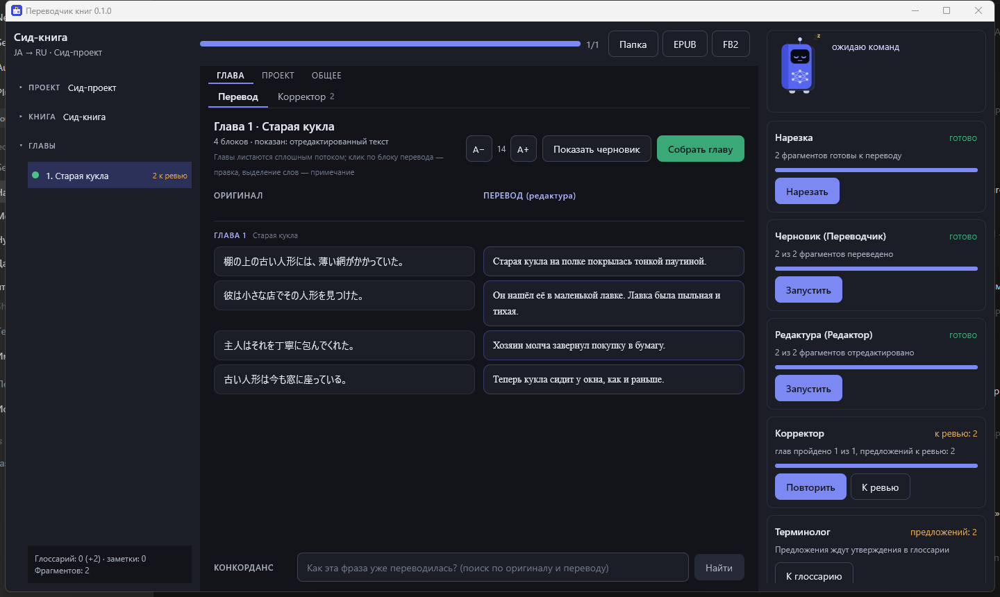
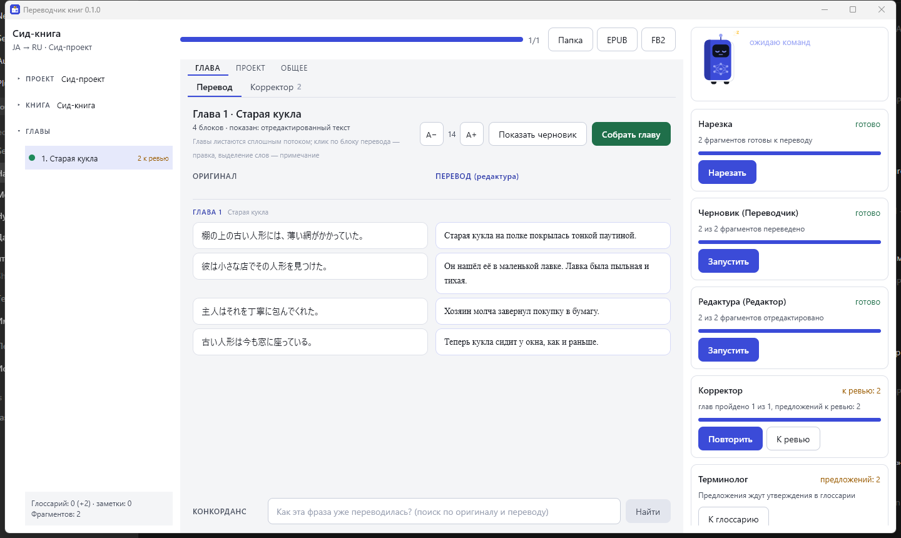
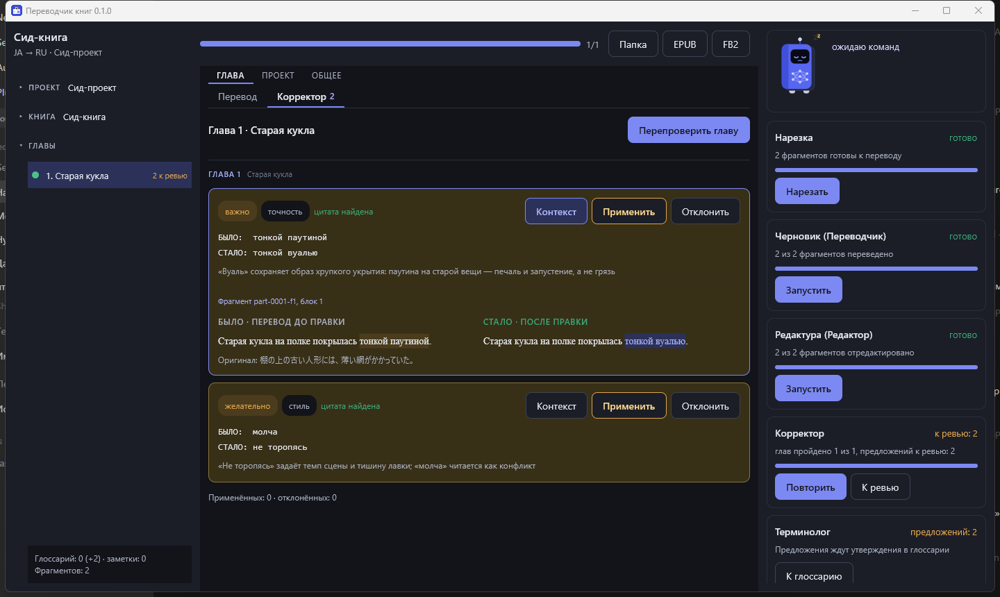
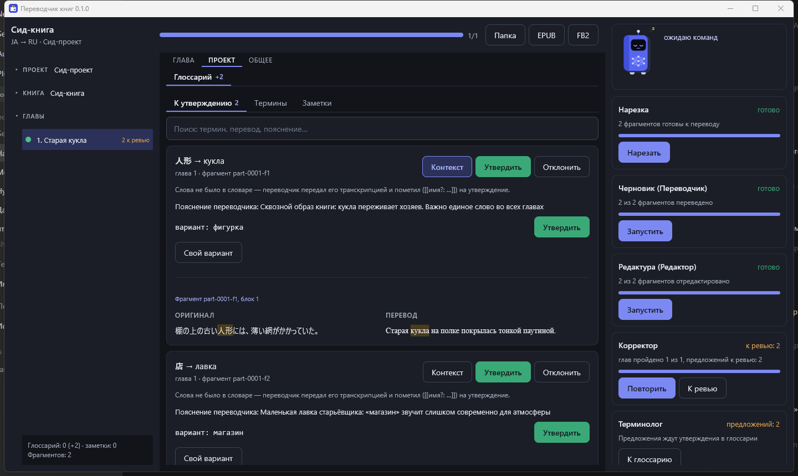
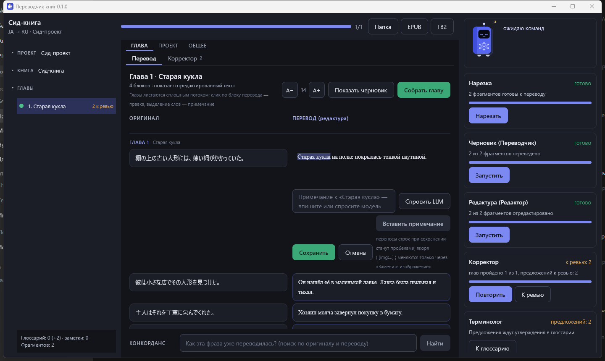
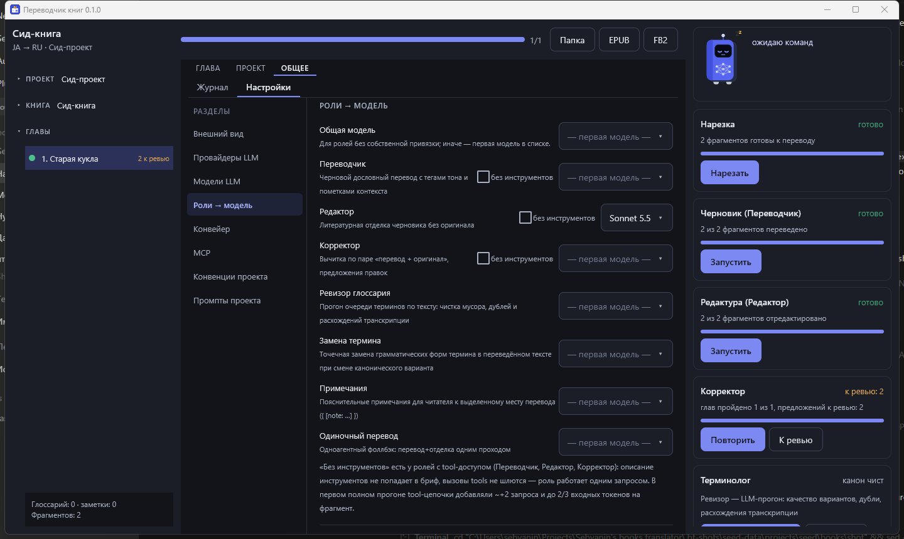

# Переводчик книг (BookTranslator)

Десктопное приложение для перевода книг через конвейер LLM-агентов.
Compose Multiplatform (Desktop: Windows + Linux), Kotlin. Реализует наработанный
на проекте «Genkoku» процесс: черновик → литературная редактура → корректор → сборка.

## Как это выглядит

Скриншоты сняты на встроенном сид-проекте с синтетическими данными
(сцена про старую куклу, ja → ru).

| Рабочая зона — тёмная тема | Светлая тема |
|---|---|
|  |  |

| Корректор | Глоссарий |
|---|---|
|  |  |

| Правка блока и примечания | Настройки: роли → модели |
|---|---|
|  |  |

Слева — проект/книга/главы, в центре — вкладки скоупов (глава → «Перевод» и
«Корректор», проект → «Глоссарий», общее → «Журнал» и «Настройки»), справа —
маскот-статус и карточки этапов конвейера. Главы листаются сплошным потоком,
без переключения закладок. В «Корректоре» — предложения «было → стало» с
цитатой и контекстом места прямо в карточке; в «Глоссарии» — очередь терминов
на утверждение с пояснением переводчика и парой «оригинал/перевод»; клик по
блоку перевода открывает правку с примечаниями (вручную или от LLM).

## Запуск

Ничего глобально ставить не нужно — Gradle wrapper сам скачает Gradle и зависимости
(нужен только JDK 17+; разработка идёт на JDK 21+26, байткод таргетится на 21).

```bash
# Windows
gradlew.bat :desktop:run
# или просто
run.bat

# Linux / NixOS
./gradlew :desktop:run
# или
./run.sh
```

Первый запуск скачивает зависимости (~2–3 минуты). IntelliJ IDEA открывает проект как есть.

## Конвейер

Каждый этап запускается **пользователем** из шапки и пишет файлы на диск — работа
возобновима с любого места (манифест `work/manifest.json`).

| Этап | Что делает |
|---|---|
| Импорт | EPUB/FB2 → главы → блоки (абзацы). Детерминированный код, без LLM |
| Нарезка | Главы → части ≤5000 зн. → фрагменты ≈1700 зн. (настраивается) |
| Черновик | Роль «Переводчик»: дословный черновик с тегами тона и `[[имя?: …]]` |
| Терминолог | Предложения терминов (из маркеров) и заметок — в очередь на утверждение |
| Редактура | Роль «Редактор»: литературная отделка **без оригинала** |
| Корректор | Роль «Корректор»: пары «перевод+оригинал» → предложения «было→стало→почему» |
| Сборка главы | Склейка фрагментов, счёт блоков, выравнивание «оригинал↔перевод» |
| EPUB/FB2/QA | Сборка книг (сноски из `{ [note:…] }`), финальные проверки |

После каждого шага — автопроверка (verify): блоки 1:1, якоря (`{ [img:…] }`,
`◇　◇　◇`, `<!-- … -->`) на местах, остаточная кана/CJK (пресет ja), коридор длины,
`-тся/-ться`, «?!», кавычки, глоссарный grep.

## Знания проекта

- `conventions.md` — типографика и стиль серии; идёт в каждый бриф.
- `glossary.json` — канон «термин → перевод»; меняет только человек.
- `notes.json` — «библия перевода»: голоса персонажей, обращения, манеры,
  привязанные к сущности и ситуации. В бриф попадают только заметки
  встречающихся во фрагменте сущностей.

## LLM

Два протокола: OpenAI-совместимый chat/completions (OpenAI, GLM (api.z.ai),
DeepSeek, OpenRouter, локальные Ollama/LM Studio) и Anthropic Messages
(api.anthropic.com и совместимые шлюзы). Провайдер (адрес + ключ + протокол)
задаётся один раз, модели ссылаются на него — только id и параметры генерации;
привязка «роль → модель» глобальная или per-project. Настройки: «Провайдеры LLM»
и «Модели LLM» на вкладке настроек.
Промпты: глобальные дефолты (двухуровневые, с предпросмотром брифа) + копия
в проекте для кастомизации.

Агентам доступны read-only инструменты (function calling, отключаемо):
`glossary_lookup`, `notes_lookup`, `alignment_search`, `read_context`, `source_search`.

## Данные

Всё — файлами, в `<Documents>/BookTranslator/` (корень настраивается):

```
projects/<слаг>/project.json, glossary.json, notes.json, conventions.md, prompts/
  books/<слаг>/book.json
    source/          главы (markdown-подобный формат блоков) + structure.json
    work/            манифест, части, фрагменты (src/draft/edited), критика
    translation/     собранные главы + выравнивание (абзацы 1:1 + предложения)
    build/           готовые EPUB/FB2
```

## MCP (внешнее управление)

Включается в Настройках → MCP (Streamable HTTP, `http://127.0.0.1:<port>/mcp`).
Инструменты (17): обзор проектов/книг/статусов, запуск этапов, глоссарий и
ревизор, конкорданс-поиск, предложения корректора и сомнения — и поток
«агент переводит сам»: бриф фрагмента + приём перевода с верификацией,
токены приложения не тратятся.

Подключение MCP-клиента — см. [docs/MCP.md](docs/MCP.md).

## Версии и релизы

Версия живёт в одном месте — `gradle.properties` (`version=N.N.N`, формат строго
`N.N.N` — ограничение jpackage для MSI). Она же попадает в заголовок окна.

Релиз собирается GitHub Actions (`.github/workflows/release.yml`) и триггерится
**только сменой версии**: пуш в master сверяет `version` с тегом `v<версия>` —
если тег уже существует, сборка не запускается вовсе; если версия новая — на
обоих раннерах собираются дистрибутивы и публикуется GitHub Release с тегом
`v<версия>` и готовыми файлами:

- `BookTranslator-<v>-windows-x64.msi` — установщик Windows;
- `BookTranslator-<v>-windows-portable.zip` — распаковать и запустить `BookTranslator.exe`;
- `BookTranslator-<v>-linux-amd64.deb` — пакет Debian/Ubuntu;
- `BookTranslator-<v>-linux-portable.zip` — распаковать и запустить `bin/BookTranslator`
  (свой JRE внутри, на NixOS работает как есть).

Как выпустить новую версию:

```bash
# 1. Поднять версию в gradle.properties, например 0.1.0 → 0.1.1
# 2. Закоммитить и запушить в master — дальше CI всё сделает сам
```

Release notes генерируются автоматически (список коммитов с прошлого тега).
Ручной запуск воркфлоу (`workflow_dispatch`) с галкой «force» пересобирает
текущую версию даже без смены версии.

Локально всё то же самое можно собрать руками:

```bash
gradlew :desktop:packageDistributionForCurrentOS   # MSI на Windows, deb/rpm на Linux
gradlew :desktop:createDistributable               # portable-папка (desktop/build/compose/binaries/main/app)
```

## Структура кода

- `core/` — вся логика (Kotlin/JVM, без UI): парсеры, конвейер, LLM-клиент,
  verify, знания, выравнивание, билдеры, MCP.
- `desktop/` — Compose Desktop UI (собственная тема в `ui/theme/BtTheme.kt`).

Тесты: `gradlew test` (детерминированная часть конвейера — нарезка/сборка/verify).

## Лицензия

Код — [MIT](LICENSE). Лицензии сторонних зависимостей перечислены в
[THIRD-PARTY-NOTICES.md](THIRD-PARTY-NOTICES.md).

Тестовая книга `test-data/akutagawa-test.epub` собрана скриптом из рассказов
Рюноскэ Акутагавы («Паутина», «В чаще») с Aozora Bunko — общественное достояние.

## Про ИИ-разработку

Проект разрабатывался с активным использованием ИИ-ассистентов — GLM (Z.ai) и
Claude (Anthropic) — под управлением автора: архитектура, продуктовые решения и
приёмка — человека, значительная часть кода и артов (макеты интерфейса, маскот)
сгенерирована моделями.
